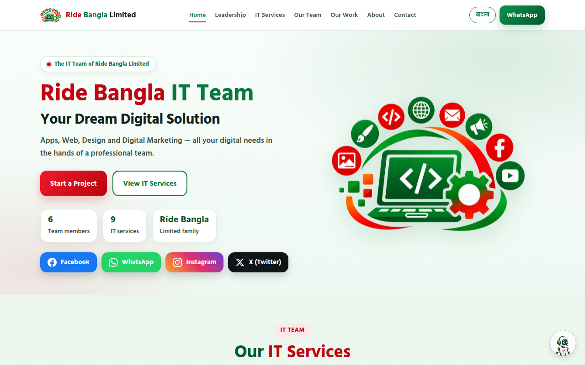
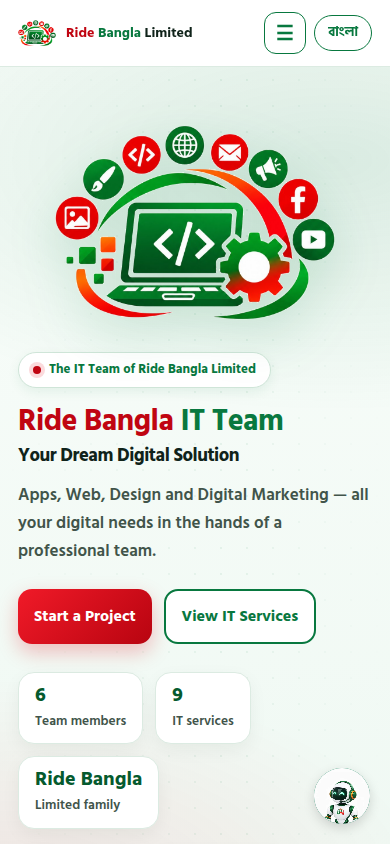
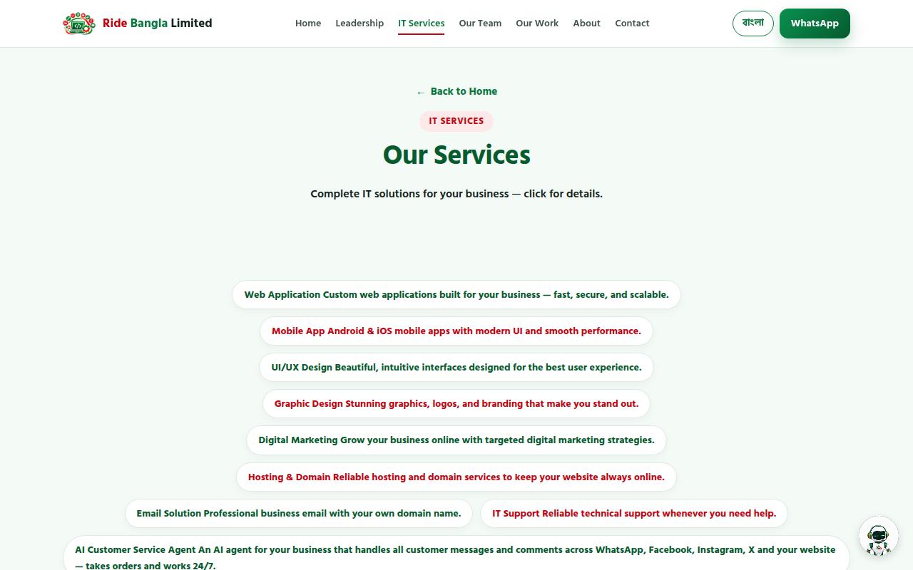
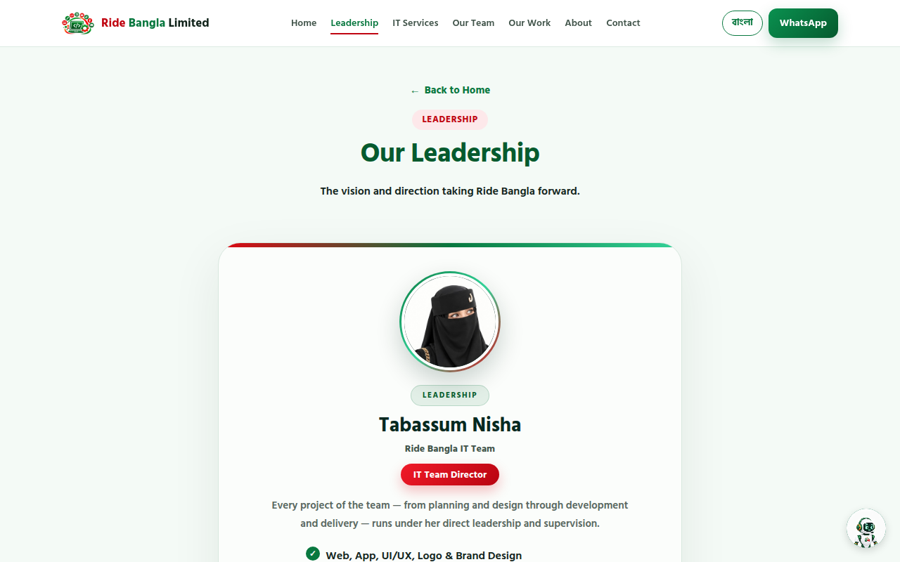

# Ride Bangla IT Team

**Your Dream Digital Solution — Apps, Web, Design and Digital Marketing, all your digital needs in the hands of a professional team.**

*The IT services team of Ride Bangla Limited — Faridpur, Bangladesh*

  
   
  The live homepage — desktop screenshot (laptop viewport, 1280×800), captured 2026-10-23 from <a href="https://it.ridebangla.bd">it.ridebangla.bd</a>.

---

## About

**Ride Bangla IT Team** is the in-house technology team of **Ride Bangla Limited**. The team builds the company's own apps, websites, design and digital marketing — and offers the same quality of service to outside clients.

This repository contains the team's official public website: a fast, fully static site (no build step) presenting its services, leadership, portfolio and contact channels. The site opens in **English by default** and switches to **বাংলা** from the on-page language toggle. Ride Bangla's own **AI Agent help widget** is present on every page, so a visitor can ask a question anywhere on the site.

| At a glance | |
|---|---|
| Team members | 6 |
| IT services | 9 (8 own service pages + the AI Customer Service Agent) |
| Pages | 13 static pages |
| Languages | English (default) · বাংলা toggle |
| Location | Faridpur, Bangladesh |

---

## Services

Complete IT solutions for your business — every service below has its own page on the live site.

### 🌐 Web Application

Custom web applications built for your business — fast, secure, and scalable.

➡️ [service-web-application.html](https://it.ridebangla.bd/service-web-application.html)

### 📱 Mobile App

Android & iOS mobile apps with modern UI and smooth performance.

➡️ [service-mobile-app.html](https://it.ridebangla.bd/service-mobile-app.html)

### 🎨 UI/UX Design

Beautiful, intuitive interfaces designed for the best user experience.

➡️ [service-ui-ux-design.html](https://it.ridebangla.bd/service-ui-ux-design.html)

### 🖌️ Graphic Design

Stunning graphics, logos, and branding that make you stand out.

➡️ [service-graphic-design.html](https://it.ridebangla.bd/service-graphic-design.html)

### 📣 Digital Marketing

Grow your business online with targeted digital marketing strategies.

➡️ [service-digital-marketing.html](https://it.ridebangla.bd/service-digital-marketing.html)

### 🗄️ Hosting & Domain

Reliable hosting and domain services to keep your website always online.

➡️ [service-hosting-domain.html](https://it.ridebangla.bd/service-hosting-domain.html)

### ✉️ Email Solution

Professional business email with your own domain name.

➡️ [service-email-solution.html](https://it.ridebangla.bd/service-email-solution.html)

### 🛠️ IT Support

Reliable technical support whenever you need help.

➡️ [service-it-support.html](https://it.ridebangla.bd/service-it-support.html)

### 🤖 AI Customer Service Agent

An AI agent for your business that handles customer messages and comments across WhatsApp, Facebook, Instagram, X and your website — takes orders and works 24/7. Offered through the Ride Bangla AI Agent platform.

➡️ [ai.ridebangla.bd](https://ai.ridebangla.bd)

---

## How It Works

Planning, design, development and support — in one place, as the site itself describes the team's process:

1. **Send your project inquiry** — use the [contact page](https://it.ridebangla.bd/contact.html): your name, mobile number, email, type of work, budget and project details. The form is WhatsApp-first, with email as a fallback.
2. **Planning & design** — every project is guided under the IT Team Director's direction, from planning and design through development and delivery.
3. **Development** — the team's specialists (IT Support Engineer, UI/UX Designer, Full Stack Developer, Web Developer, Database Administrator) build the work.
4. **Delivery & support** — the team ensures quality and on-time delivery of client projects, with IT support available after delivery.

---

## Leadership

The four leaders of Ride Bangla, as presented on the [leadership page](https://it.ridebangla.bd/leadership.html):

<table>
  <tr>
    <td align="center" width="25%">
       
      <strong>Tabassum Nisha</strong> 
      Director, IT Team
    </td>
    <td align="center" width="25%">
       
      <strong>Enamul Seddik</strong> 
      Co-Founder &amp; CEO
    </td>
    <td align="center" width="25%">
       
      <strong>Emon Seddik</strong> 
      Co-Founder &amp; Director
    </td>
    <td align="center" width="25%">
       
      <strong>Obayedur Rahman Shaikh</strong> 
      Co-Founder &amp; Marketing Director
    </td>
  </tr>
</table>

- **Tabassum Nisha — Director, IT Team.** Every project of the team — from planning and design through development and delivery — runs under her direct leadership and supervision: web, app, UI/UX, logo & brand design, digital marketing and graphics design, ensuring quality and on-time delivery.
- **Enamul Seddik — Co-Founder & CEO.** Leads the company's vision, strategy and growth, and oversees every service of the Ride Bangla ecosystem. *"Together We Move, A Better Tomorrow."*
- **Emon Seddik — Co-Founder & Director.** Plays a key role in the company's operations and growth — company operations and strategic decisions, business expansion and partnerships.
- **Obayedur Rahman Shaikh — Co-Founder & Marketing Director.** Leads brand, marketing and customer engagement — brand strategy and marketing leadership, customer engagement and growth.

---

## Our Work

The homepage portfolio is rendered from [`data/portfolio.json`](data/portfolio.json) — **7 design works** and **5 work videos** (MP4 + poster), each with bilingual titles.

  
  
  

| Design work | Type |
|---|---|
| Mastul Perfumes — Poster Design | Poster |
| Mastul Perfumes — Banner | Banner |
| Mastul Perfumes — Logo & Brand Identity | Logo |
| Bunora Burgers — Brand Identity | Branding |
| Structon — Brand Identity | Branding |
| Cream & Crumb — Brand Identity | Branding |
| Bakery Website Design | Web Design |

Work videos: *Live Coding & App Preview · App Login UI Development · Pizza Mood — Food App UI · Face ID Login UI · Mastul Perfumes — Promo Video.*

---

## The Team

Alongside the Director, the homepage presents the team's specialist roles: **IT Support Engineer** (smooth tech support), **UI/UX Designer** (user-friendly design), **Full Stack Developer** (robust web solutions), **Web Developer** (responsive web) and **Database Administrator** (secure data systems).

---

## Reviews

The homepage carries a **"What Our Customers Say"** section. It reads approved reviews from the shared Firestore collection `website_reviews` — the same review pool as the main Ride Bangla website — via [`assets/js/reviews.js`](assets/js/reviews.js). There is no fake or seeded data: an empty pool renders an honest empty state, and a failed fetch renders a distinct "temporarily unavailable" state.

---

## Features

- **Bilingual EN | বাংলা** — English by default; the toggle rewrites the page in place and remembers the choice (`localStorage`).
- **AI Agent on every page** — Ride Bangla's own help agent (floating widget sitewide; an inline help box on the Contact page).
- **Data-driven portfolio** — designs and videos load from `data/portfolio.json`, with in-page fallback data.
- **WhatsApp-first contact** — the contact form composes a WhatsApp message to the IT Team, with an email fallback to `info@ridebangla.bd`.
- **Shared reviews** — approved customer reviews from the same Firestore pool as the main website, with an honest empty/unavailable state when no review data can be shown.
- **Full icon set** — favicon, apple-touch icon and maskable PWA icons; `site.webmanifest` included.
- **Responsive** — navigation, hero, cards and portfolio adapt to phone, tablet and desktop.

---

## Screenshots Gallery

  
   
  Live homepage — desktop (1280×800), captured 2026-10-23 from it.ridebangla.bd.
    
  
   
  Live homepage — phone (390×844), captured 2026-10-23 from it.ridebangla.bd.
    
  
   
  Live services page (<code>services.html</code>) — desktop, captured 2026-10-23.
    
  
   
  Live leadership page (<code>leadership.html</code>) — desktop, captured 2026-10-23.

> All screenshots in this gallery are fresh captures of the live site at it.ridebangla.bd, taken 2026-10-23 (public pages only).

---

## Tech Stack

| Layer | Technology |
|---|---|
| Markup | HTML5 (13 static pages) |
| Styling | CSS3 (inline per page, responsive) |
| Behaviour | Vanilla JavaScript (language system, portfolio, forms) |
| Data | JSON (`data/portfolio.json`) |
| Reviews | Firestore REST API — shared `website_reviews` pool (`assets/js/reviews.js`) |
| Dynamic layers | "Latest Updates" feed (`assets/js/it-updates.js`) and admin photo overrides (`assets/js/site-photos.js`) — code-ready, inert until the site's own Firebase web config is added |
| Help system | Ride Bangla AI Agent widget |
| Hosting | Vercel (static, `vercel.json` headers) |
| Repository | GitHub |

No framework, no `npm install`, no build command — the repo deploys as-is.

> **Version note:** Firebase **10.14.1** is the only pinned library version in this repo — the `SDK_VERSION` constant in [`assets/js/reviews.js`](assets/js/reviews.js), [`assets/js/it-updates.js`](assets/js/it-updates.js) and [`assets/js/site-photos.js`](assets/js/site-photos.js) (lazy-loaded Firebase compat SDK). This repo has no `package.json` or lockfile and pins no other versions, so HTML5, CSS3, JavaScript, JSON and Vercel carry no version number above rather than an invented one.

### Pages

| Page | What it covers |
|---|---|
| [Home](https://it.ridebangla.bd/) | Company + IT Team introduction, services, team, portfolio, reviews, contact |
| [About](https://it.ridebangla.bd/about.html) | The team, the company, the certificate |
| [Leadership](https://it.ridebangla.bd/leadership.html) | The four leaders of Ride Bangla |
| [Services](https://it.ridebangla.bd/services.html) | All IT services in one place |
| [Contact](https://it.ridebangla.bd/contact.html) | WhatsApp-first contact form, email fallback, AI help box |
| 8 service pages | One page per service (see [Services](#services)) |

---

## Security

- `vercel.json` serves HSTS (preload), a Content-Security-Policy, `X-Content-Type-Options`, `X-Frame-Options`, `Referrer-Policy` and `Permissions-Policy` on every route.
- `.well-known/security.txt` is published for vulnerability reports.
- No secrets or API keys are stored in this repository.
- Report a vulnerability privately — see [SECURITY.md](SECURITY.md) (support@ridebangla.bd). Please do not open a public issue for a security problem.

---

## The Ride Bangla Ecosystem

This site is one part of Ride Bangla Limited. Discover the rest:

| Service | Link |
|---|---|
| Ride Bangla — main website | [ridebangla.bd](https://ridebangla.bd) |
| AI Customer Service Agent | [ai.ridebangla.bd](https://ai.ridebangla.bd) |
| Ride Bangla Studio | [studio.ridebangla.bd](https://studio.ridebangla.bd) |
| Ride Bangla Tools | [tools.ridebangla.bd](https://tools.ridebangla.bd) |
| Ride Bangla IT Team | [it.ridebangla.bd](https://it.ridebangla.bd) |
| Customer | [customer.ridebangla.bd](https://customer.ridebangla.bd) |
| Partner | [partner.ridebangla.bd](https://partner.ridebangla.bd) |
| Rider | [rider.ridebangla.bd](https://rider.ridebangla.bd) |
| Agent | [agent.ridebangla.bd](https://agent.ridebangla.bd) |

---

## Contact & Community

- **Website:** [it.ridebangla.bd](https://it.ridebangla.bd)
- **Email:** info@ridebangla.bd · support@ridebangla.bd
- **WhatsApp (IT Team contact page):** +880 1825-234644
- **Location:** Faridpur, Bangladesh

Follow Ride Bangla:

Join the official community: [Ride Bangla Community (Facebook group)](https://www.facebook.com/share/g/1CfmiTzv1D/)

---

## License

Proprietary — © 2026 Ride Bangla Limited. All rights reserved. See [LICENSE](LICENSE).

Client work is handed over under a separate written agreement; see [CLIENT-LICENSE-TEMPLATE.txt](CLIENT-LICENSE-TEMPLATE.txt).
