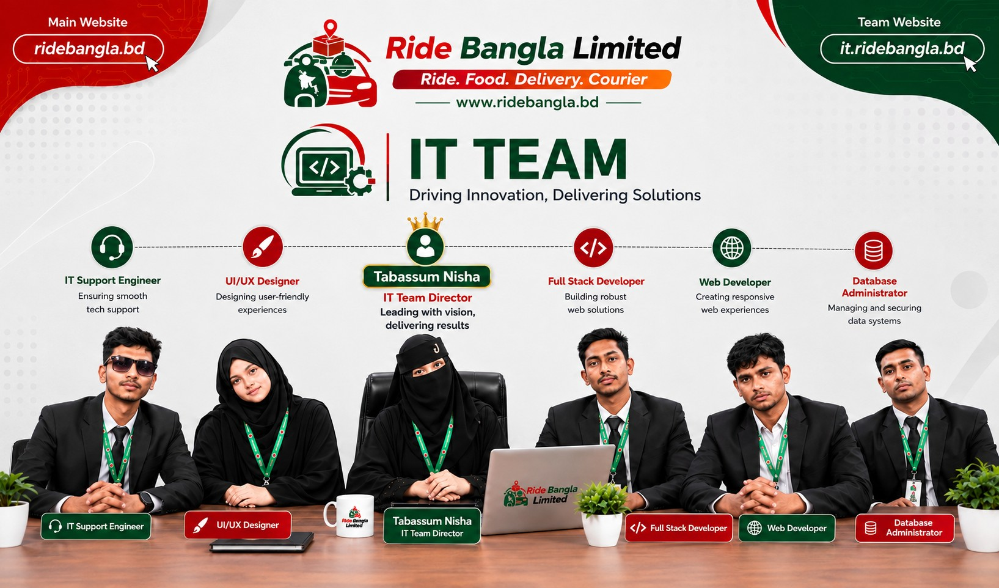
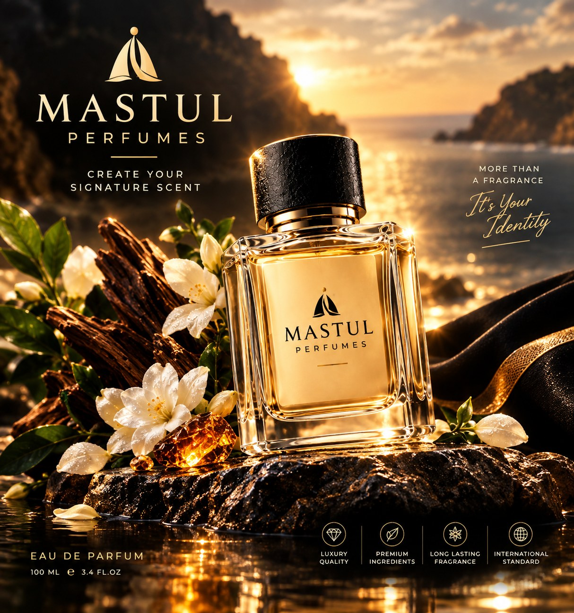
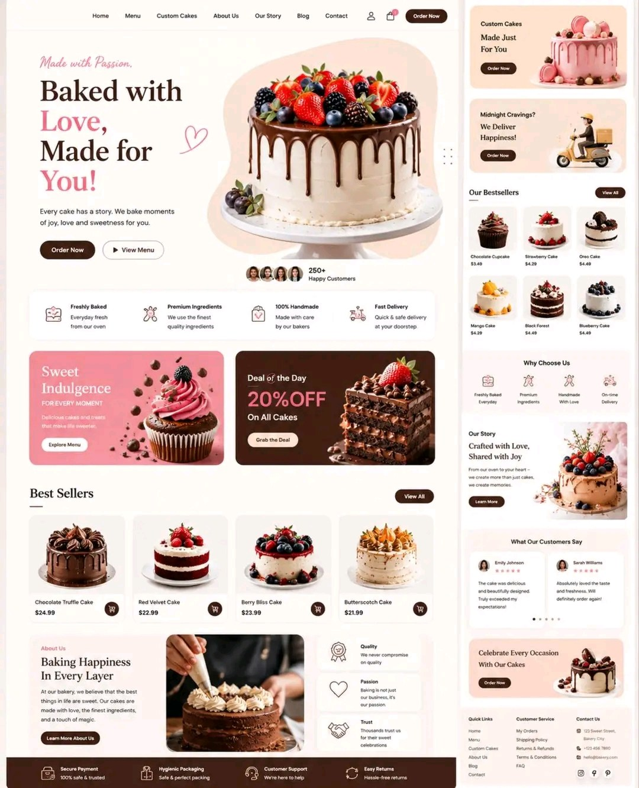

<p align="center">
  
</p>

<h1 align="center">Ride Bangla IT Team</h1>

<h3 align="center">
  Apps • Web • Design & Digital Marketing
</h3>

<p align="center">
  <strong>The official website of the IT Team of Ride Bangla Limited</strong><br/>
  Production • Static Website • Bilingual EN | বাংলা • Vercel
</p>

<p align="center">
  <a href="https://it.ridebangla.bd/"><strong>🌐 Live Website — it.ridebangla.bd</strong></a>
</p>

<p align="center">
  
  
  
  
  
  
</p>

---

## 📖 About

**Ride Bangla IT Team** is the technology team of **Ride Bangla Limited**. This repository holds the team's official public website — a fast, fully static site (no build step) that presents the team's services, leadership, portfolio and contact channels to clients in Bangladesh and around the world.

The site is bilingual: it opens in **English by default** and switches to **বাংলা** from the on-page language toggle. Ride Bangla's own **AI Agent help widget** is present on every page, so a visitor can ask a question anywhere on the site and reach the company.

<p align="center">
  
</p>

---

## 📌 Status at a Glance

| Area | Status |
|---|---|
| Website | ✅ Live — all 13 pages |
| AI Agent help widget | ✅ On every page |
| Language | ✅ English default + বাংলা toggle |
| Portfolio | ✅ 7 design works + 5 work videos |
| International SEO | ✅ Done (2026-10-22) |
| Security headers | ✅ Live via `vercel.json` |
| Help Center voice messages | ✅ Microphone allowed for this site's own origin (`microphone=(self)`) — the embedded AI Agent's voice recording is unblocked; camera/geolocation unchanged |
| Latest Updates / photo overrides (Firebase) | 🔧 Code ready — waiting for the site's Firebase web config |
| `www` subdomain | 🔧 To be attached in Vercel |

Full detail is in [Project Status](#-project-status) below.

---

## 🌐 Pages

| Page | What it covers |
|---|---|
| [Home](https://it.ridebangla.bd/) | Company + IT Team introduction, services, portfolio, director, contact |
| [About](https://it.ridebangla.bd/about.html) | The team, the company, the certificate |
| [Leadership](https://it.ridebangla.bd/leadership.html) | The four leaders of Ride Bangla |
| [Services](https://it.ridebangla.bd/services.html) | All IT services in one place |
| [Contact](https://it.ridebangla.bd/contact.html) | WhatsApp-first contact form, email fallback, AI help box |
| 8 service pages | One page per service (below) |

---

## 🛠️ Services

| Service | Page |
|---|---|
| Web Application | [service-web-application.html](https://it.ridebangla.bd/service-web-application.html) |
| Mobile App | [service-mobile-app.html](https://it.ridebangla.bd/service-mobile-app.html) |
| UI/UX Design | [service-ui-ux-design.html](https://it.ridebangla.bd/service-ui-ux-design.html) |
| Graphic Design | [service-graphic-design.html](https://it.ridebangla.bd/service-graphic-design.html) |
| Digital Marketing | [service-digital-marketing.html](https://it.ridebangla.bd/service-digital-marketing.html) |
| Hosting & Domain | [service-hosting-domain.html](https://it.ridebangla.bd/service-hosting-domain.html) |
| Email Solution | [service-email-solution.html](https://it.ridebangla.bd/service-email-solution.html) |
| IT Support | [service-it-support.html](https://it.ridebangla.bd/service-it-support.html) |

---

## 👥 Leadership

<table>
  <tr>
    <td align="center" width="25%">
      <br/>
      <strong>Tabassum Nisha</strong><br/>
      IT Team Director
    </td>
    <td align="center" width="25%">
      <br/>
      <strong>Enamul Seddik</strong><br/>
      Co-Founder & CEO
    </td>
    <td align="center" width="25%">
      <br/>
      <strong>Emon Seddik</strong><br/>
      Co-Founder & Director
    </td>
    <td align="center" width="25%">
      <br/>
      <strong>Obayedur Rahman Shaikh</strong><br/>
      Co-Founder & Marketing Director
    </td>
  </tr>
</table>

---

## 🎨 Our Work

The homepage portfolio is rendered from [`data/portfolio.json`](data/portfolio.json) — **7 design works** and **5 work videos** (MP4 + poster), with bilingual titles.

<p align="center">
  
  
  
</p>

---

## ✨ Features

- **Bilingual EN | বাংলা** — English by default; the toggle rewrites the page in place and remembers the choice (`localStorage`).
- **AI Agent on every page** — Ride Bangla's own help agent (floating widget sitewide; an inline help box on the Contact page).
- **Data-driven portfolio** — designs and videos load from `data/portfolio.json`, with in-page fallback data.
- **WhatsApp-first contact** — the form composes a WhatsApp message to the IT Team, with an email fallback to `info@ridebangla.bd`.
- **Firebase-ready layers** — a "Latest Updates" feed (`assets/js/it-updates.js`) and admin photo overrides (`assets/js/site-photos.js`) are built in; both stay cleanly hidden until the site's own Firebase web config is pasted in.
- **Full icon set** — favicon, apple-touch icon and maskable PWA icons; `site.webmanifest` included.
- **Responsive** — navigation, hero, cards and portfolio adapt to phone, tablet and desktop.

---

## 💻 Technology

| Layer | Technology |
|---|---|
| Markup | HTML5 (13 static pages) |
| Styling | CSS3 (inline per page, responsive) |
| Behaviour | Vanilla JavaScript (language system, portfolio, forms) |
| Data | JSON (`data/portfolio.json`) |
| Dynamic layers | Firebase Firestore via CDN SDK (config pending — see Status) |
| Help system | Ride Bangla AI Agent widget |
| Hosting | Vercel (static, `vercel.json` headers) |
| Repository | GitHub |

No framework, no `npm install`, no build command — the repo deploys as-is.

---

## 📂 Project Structure

```text
Ride-Bangla-IT-Tim/
├── index.html                 # Home
├── about.html
├── leadership.html
├── services.html
├── contact.html
├── service-web-application.html
├── service-mobile-app.html
├── service-ui-ux-design.html
├── service-graphic-design.html
├── service-digital-marketing.html
├── service-hosting-domain.html
├── service-email-solution.html
├── service-it-support.html
├── data/
│   └── portfolio.json         # 7 designs + 5 videos
├── assets/
│   ├── it-logo-transparent.png  # Logo used across the website
│   ├── logo.png                 # Full IT Team logo (this README)
│   ├── enamul-seddik.jpg / emon-seddik.jpg
│   ├── tabassum-nisha.jpg / obayedur-rahman-shaikh.jpg
│   ├── team.jpg / workspace.jpg / certificate.jpg
│   ├── director.png / services-main.jpg / services-it.jpg
│   ├── portfolio/               # 7 design images
│   ├── videos/                  # work-1 … work-5 (.mp4 + .jpg posters)
│   ├── favicon.ico / favicon.png
│   ├── apple-touch-icon.png / icon-192.png / icon-512.png
│   ├── icon-maskable-192.png / icon-maskable-512.png
│   └── js/
│       ├── it-updates.js        # Latest Updates (Firebase, config pending)
│       └── site-photos.js       # Admin photo overrides (Firebase, config pending)
├── site.webmanifest
├── sitemap.xml
├── robots.txt
├── .well-known/security.txt
├── vercel.json                  # Security headers
├── LICENSE / CLIENT-LICENSE-TEMPLATE.txt
├── SECURITY.md / CODE_OF_CONDUCT.md / CONTRIBUTING.md
└── README.md
```

---

## 🔒 Security

- `vercel.json` serves HSTS (preload), a Content-Security-Policy, `X-Content-Type-Options`, `X-Frame-Options`, `Referrer-Policy` and `Permissions-Policy` on every route.
- `.well-known/security.txt` is published for vulnerability reports; see also [SECURITY.md](SECURITY.md).
- No secrets or API keys are stored in this repository. The Firebase values in the two loader scripts are placeholders by design until the owner pastes the site's own public web config.

## 🔍 SEO

- International-facing English metadata on all 13 pages.
- Service structured data (JSON-LD) declares `areaServed: "Worldwide"`.
- `og:locale` `en_US` with `bn_BD` alternate on every page; sitemap refreshed 2026-10-22.
- Language switching is a same-URL toggle, so no hreflang is used (the WebSite schema declares `inLanguage: ["en", "bn"]`).

---

## 📌 Project Status

_Last updated: 2026-10-22._

**Done**

- The website is live at [it.ridebangla.bd](https://it.ridebangla.bd/) — 13 static pages on Vercel, English by default with a বাংলা toggle.
- Re-audit round 2 (2026-10-22): the AI Agent help widget was added to all 13 pages (it previously appeared only on the contact page), the homepage meta description is English, and international SEO is in place.
- Owner directive (2026-10-22): the floating WhatsApp button was removed from all 13 pages — it sat next to the AI Agent widget at the bottom-right corner. The AI Agent widget is now the site's only floating button. The header WhatsApp pill, the footer social icons and the in-content/contact WhatsApp links are unchanged.
- Project cleanup (2026-10-22): no file was proven unreferenced, so nothing was deleted.

**What remains**

- Latest Updates and the admin photo-override layer are code-ready but inert until the site's own Firebase web config is pasted into the two loader scripts (owner/console step).
- `assets/ridebangla-logo.png` and `assets/favicon.png` are not referenced by any page; they can be removed on the owner's word.
- The `www` subdomain still needs to be attached in the Vercel project.
- Footer and structured-data social links currently mix the team Facebook page with the Director's personal Instagram/X accounts — an identity decision for the owner.
