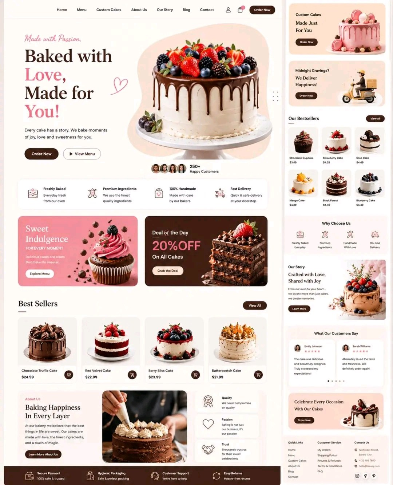
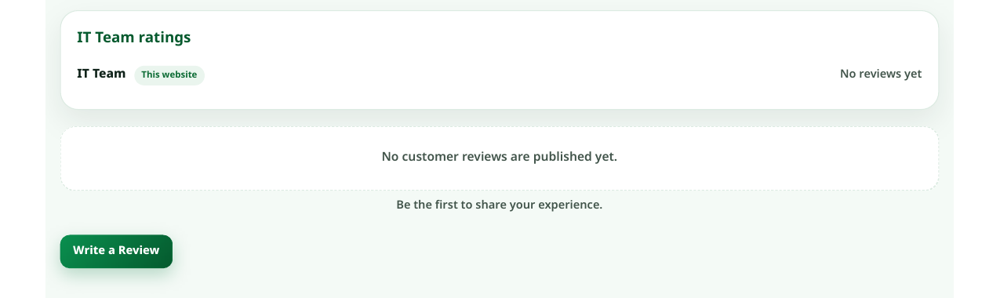
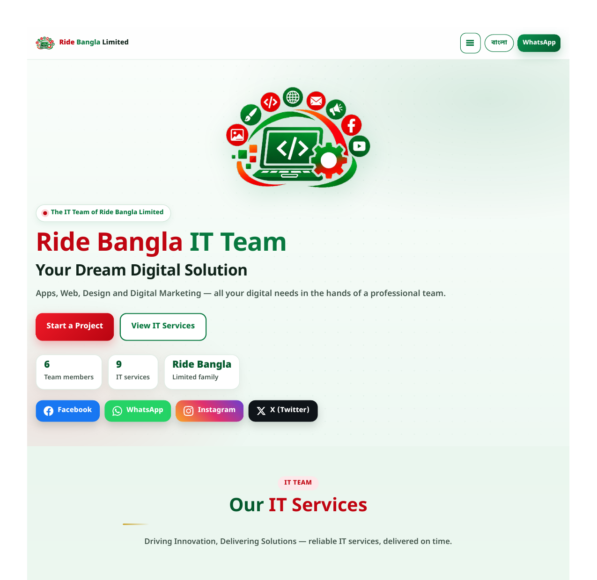
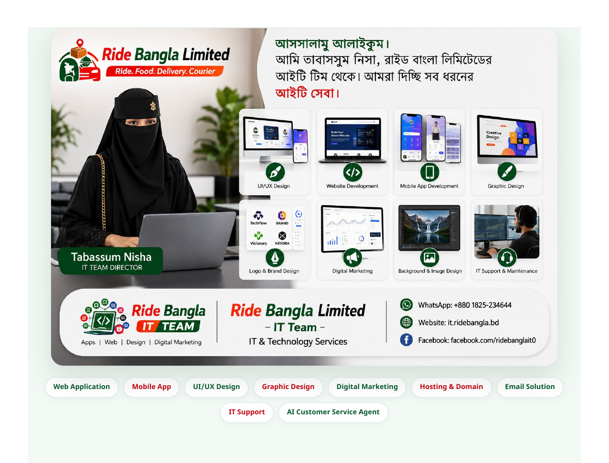
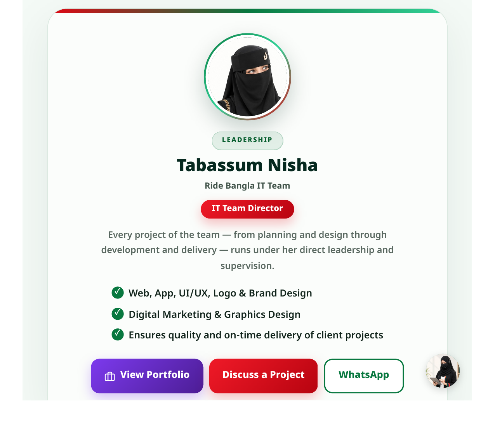
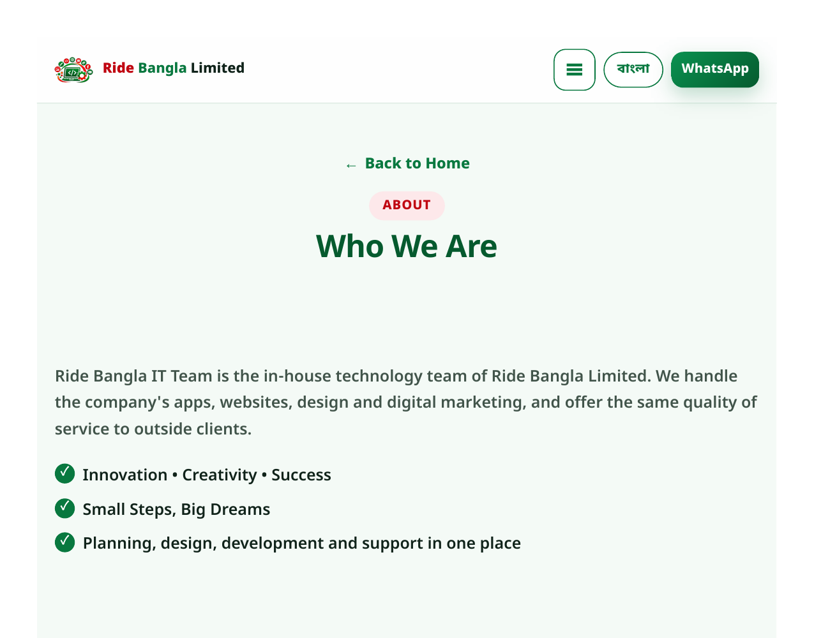
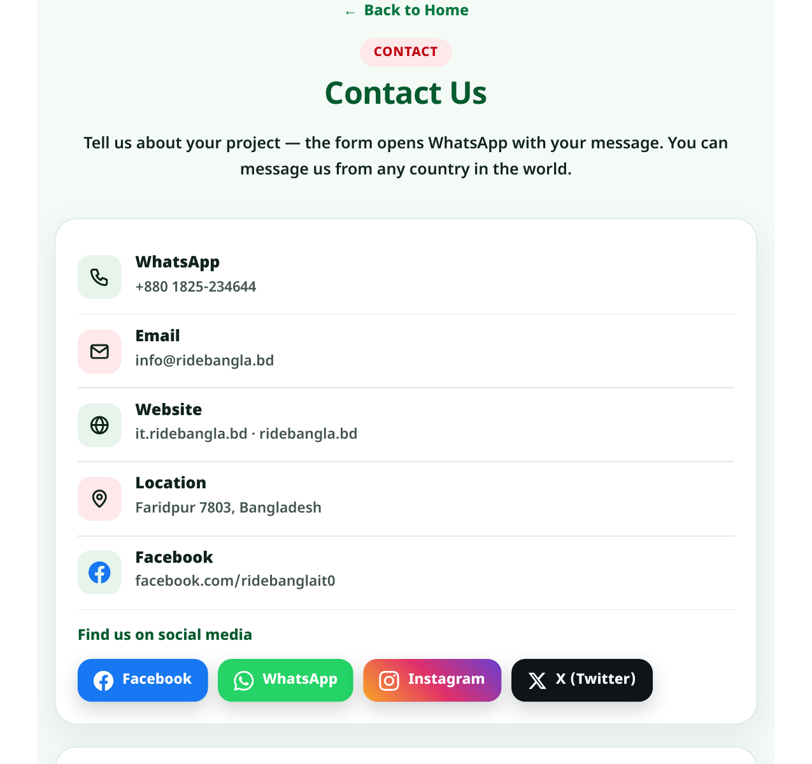

# Ride Bangla IT Team

**Your Dream Digital Solution — Apps, Web, Design and Digital Marketing, all your digital needs in the hands of a professional team.**

*The IT services team of Ride Bangla Limited — Faridpur, Bangladesh*

<!-- MEDIA: hero-video-laptop — OWED, NOT IN THIS PACKAGE -->
<!-- Laptop-screen video of the live IT site (desktop viewport, landscape): homepage hero → services → portfolio. NOT YET CAPTURED — awaiting the parent browser task. No phone video is used as a substitute. No laptop-screen GIF exists anywhere in the repo either (the only site-demo GIF, docs/demo/demo.gif, is a portrait phone recording and is never used), so no GIF fallback is available in this package — the hero video, or a genuine laptop GIF, is still owed. -->

---

## About

**Ride Bangla IT Team** is the in-house technology team of **Ride Bangla Limited**. The team builds the company's own apps, websites, design and digital marketing — and offers the same quality of service to outside clients.

This repository contains the team's official public website: a fast, fully static site (no build step) presenting its services, leadership, portfolio and contact channels. The site opens in **English by default** and switches to **বাংলা** from the on-page language toggle. Ride Bangla's own **AI Agent help widget** is embedded on all 13 content pages (the 404 page carries no widget).

| At a glance | |
|---|---|
| Team members | 6 (homepage stat) |
| IT services | 9 (8 own service pages + the AI Customer Service Agent — see the flag box below) |
| Pages | 13 static content pages (plus a 404 page) |
| Languages | English (default) · বাংলা toggle |
| Location | Faridpur, Bangladesh |

---

## Services

Complete IT solutions for your business — every service below has its own page on the live site. All services listed here are IT-sector services.

### 🌐 Web Application

Custom web applications built for your business — fast, secure, and scalable.

➡️ [service-web-application.html](https://it.ridebangla.bd/service-web-application.html)

### 📱 Mobile App

Android & iOS mobile apps with modern UI and smooth performance.

➡️ [service-mobile-app.html](https://it.ridebangla.bd/service-mobile-app.html)

### 🎨 UI/UX Design

Beautiful, intuitive interfaces designed for the best user experience.

➡️ [service-ui-ux-design.html](https://it.ridebangla.bd/service-ui-ux-design.html)

### 🖌️ Graphic Design

Stunning graphics, logos, and branding that make you stand out.

➡️ [service-graphic-design.html](https://it.ridebangla.bd/service-graphic-design.html)

### 📣 Digital Marketing

Grow your business online with targeted digital marketing strategies.

➡️ [service-digital-marketing.html](https://it.ridebangla.bd/service-digital-marketing.html)

### 🗄️ Hosting & Domain

Reliable hosting and domain services to keep your website always online.

➡️ [service-hosting-domain.html](https://it.ridebangla.bd/service-hosting-domain.html)

### ✉️ Email Solution

Professional business email with your own domain name.

➡️ [service-email-solution.html](https://it.ridebangla.bd/service-email-solution.html)

### 🛠️ IT Support

Reliable technical support whenever you need help.

➡️ [service-it-support.html](https://it.ridebangla.bd/service-it-support.html)

### 🤖 AI Customer Service Agent

An AI agent for your business that handles customer messages and comments across WhatsApp, Facebook, Instagram, X and your website — takes orders and works 24/7. Offered through the Ride Bangla AI Agent platform.

➡️ [ai.ridebangla.bd](https://ai.ridebangla.bd)

> **⚠️ FLAGGED — service-naming gap on the homepage (not filled in, not hidden):** the homepage stat says **9 IT services**, and the homepage services section does link **9 destinations** (the 8 pages above + the AI platform, as chips). But the homepage services showcase *image's own alt text* names only **6** items — **UI/UX, Website Development, Digital Marketing, Logo Design, Background Removal, IT Support** — and does not spell out the other 3 in that text. The wording also differs from the chips: the alt text says “Website Development” where the chip says “Web Application”, and “Logo Design” / “Background Removal” where the chip says “Graphic Design”. This README does **not** invent names for the 3 unnamed items, does **not** import names from the Main site, and does **not** assert that Logo Design / Background Removal are (or are not) parts of Graphic Design — that mapping is for the site owner to confirm. The gap is recorded here until the homepage text itself names all 9 the same way.

---

## How It Works

Planning, design, development and support — in one place, as the site itself describes the team's process:

1. **Send your project inquiry** — use the [contact page](https://it.ridebangla.bd/contact.html): your name, mobile number, email, type of work, budget and project details. The form is WhatsApp-first, with email as a fallback.
2. **Planning & design** — every project is guided under the IT Team Director's direction, from planning and design through development and delivery.
3. **Development** — the team's specialists (IT Support Engineer, UI/UX Designer, Full Stack Developer, Web Developer, Database Administrator) build the work.
4. **Delivery & support** — the team ensures quality and on-time delivery of client projects, with IT support available after delivery.

---

## Leadership

The four leaders of Ride Bangla, as presented on the [leadership page](https://it.ridebangla.bd/leadership.html):

<table>
  <tr>
    <td align="center" width="25%">
       
      <strong>Tabassum Nisha</strong> 
      Director, IT Team
    </td>
    <td align="center" width="25%">
       
      <strong>Enamul Seddik</strong> 
      Co-Founder &amp; CEO
    </td>
    <td align="center" width="25%">
       
      <strong>Emon Seddik</strong> 
      Co-Founder &amp; Director
    </td>
    <td align="center" width="25%">
       
      <strong>Obayedur Rahman Shaikh</strong> 
      Co-Founder &amp; Marketing Director
    </td>
  </tr>
</table>

- **Tabassum Nisha — Director, IT Team.** Every project of the team — from planning and design through development and delivery — runs under her direct leadership and supervision: web, app, UI/UX, logo & brand design, digital marketing and graphics design, ensuring quality and on-time delivery.
- **Enamul Seddik — Co-Founder & CEO.** Leads the company's vision, strategy and growth, and oversees every service of the Ride Bangla ecosystem. *"Together We Move, A Better Tomorrow."*
- **Emon Seddik — Co-Founder & Director.** Plays a key role in the company's operations and growth — company operations and strategic decisions, business expansion and partnerships.
- **Obayedur Rahman Shaikh — Co-Founder & Marketing Director.** Leads brand, marketing and customer engagement — brand strategy and marketing leadership, customer engagement and growth.

---

## Our Work

The homepage portfolio is rendered from [`data/portfolio.json`](data/portfolio.json) — **7 design works** and **5 work videos** (MP4 + poster), each with bilingual titles.

  
  
  

| Design work | Type |
|---|---|
| Mastul Perfumes — Poster Design | Poster |
| Mastul Perfumes — Banner | Banner |
| Mastul Perfumes — Logo & Brand Identity | Logo |
| Bunora Burgers — Brand Identity | Branding |
| Structon — Brand Identity | Branding |
| Cream & Crumb — Brand Identity | Branding |
| Bakery Website Design | Web Design |

Work videos: *Live Coding & App Preview · App Login UI Development · Pizza Mood — Food App UI · Face ID Login UI · Mastul Perfumes — Promo Video.*

Note: these 5 videos are portfolio work videos (screen recordings of builds and UI work). They are **not** a demo video of the IT website itself, and none of them is substituted for the owed laptop-screen site demo above.

---

## The Team

Alongside the Director, the homepage presents the team's specialist roles: **IT Support Engineer** (smooth tech support), **UI/UX Designer** (user-friendly design), **Full Stack Developer** (robust web solutions), **Web Developer** (responsive web) and **Database Administrator** (secure data systems). Role cards lay out 5 across on desktop, 3 across on tablet, 2 across on phones.

---

## Reviews — IT-site reviews only, including your own-review edit and delete

The homepage carries a **"What Our Customers Say"** section. It reads from the Firestore collection `website_reviews` via [`assets/js/reviews.js`](assets/js/reviews.js) (`reviews.js?v=7` at this HEAD) — but what a visitor sees here is **this site's reviews only**: cards are filtered to `sourceSite == "it"`, and the ratings block renders only the IT row (stars + count, no other site's row, no overall row). There is no fake or seeded data: an empty pool renders an honest empty state, and a failed fetch renders a distinct "temporarily unavailable" state. No live review count or rating figure is snapshotted in this README — the live pool changes, and a static figure would go stale.

  
   <em>Reviews section as captured 2026-11-01 — the live pool's empty state on that date (cropped from home-PDF page 5 to the content region only). The pool changes, so this image shows the state on the capture date, not a permanent figure.</em>

**New reviews publish immediately** — a new submission is saved approved and goes live at once; there is no admin-approval waiting step.

**You can edit and delete your own review:**

- The review document id **is** the author's uid, so edit and delete target exactly the author's own document.
- **Edit** — your own IT-site review (approved or pending) can be edited from its card, through the prefilled form. An edit never changes status: approved stays approved, pending stays pending (immediate-live). **Exact labels, copied from `assets/js/reviews.js` (never reworded):** English — **“Edit your review”**; Bengali — **“আপনার রিভিউ সম্পাদনা করুন”**.
- **Delete** — available at **any status**, on the review card **and** in the form zone. Delete is **confirmation-gated (two-step)**: the first tap swaps the button for the confirmation question plus Delete / Cancel; only the confirm Delete runs the delete, and Cancel restores the button. On failure the Delete button is restored.
- **Exact delete labels, copied from `assets/js/reviews.js` (never reworded):** English — Delete button **“Delete”**, confirmation **“Delete this review?”**, Cancel **“Cancel”**; Bengali — Delete button **“মুছে ফেলুন”**, confirmation **“এই রিভিউটি মুছে ফেলবেন?”**, Cancel **“বাতিল করুন”**.
- **Delete-only cases (no edit):** a **rejected** review cannot be edited back — delete is its only path, then a fresh review can be submitted. A **cross-site** published review (belonging to another site) likewise cannot be edited here — delete stays its only path on this site.
- **No cascade claimed:** delete removes only the review document; this README does not claim any cleanup of likes or comments, which are not part of this site's review UI at this HEAD.

---

## Features

- **Bilingual EN | বাংলা** — English by default; the toggle rewrites the page in place and remembers the choice (`localStorage`).
- **AI Agent on the site** — Ride Bangla's own help agent (widget script verified on all 13 content pages; the 404 page carries no widget).
- **Data-driven portfolio** — designs and videos load from `data/portfolio.json`, with in-page fallback data.
- **WhatsApp-first contact** — the contact form composes a WhatsApp message to the IT Team, with an email fallback to `info@ridebangla.bd`.
- **IT-site reviews** — approved reviews for this site only, with an honest empty/unavailable state when no review data can be shown, plus own-review edit and delete.
- **PWA-ready** — favicon, apple-touch icon and maskable PWA icons; `site.webmanifest` included; an app-shell service worker is registered on the homepage.
- **Responsive** — navigation, hero, cards and portfolio adapt to phone, tablet and desktop.

---

## Screenshots Gallery

  
   <em>IT Team home (top) — fresh capture, 2026-11-01, cropped to a landscape band (hero through the “Our IT Services” heading) from the portrait print render; a band, not a native viewport screenshot.</em>

  
   <em>IT Team home — services section, fresh capture 2026-11-01 (cropped from home-PDF page 2 to the content region only; no content altered within the crop).</em>

  
   <em>Leadership page — IT Team Director card band, fresh capture 2026-11-01 (cropped from the portrait print render to the card band only; no content altered within the crop).</em>

  
   <em>About page — “Who We Are” band, fresh capture 2026-11-01 (cropped from the portrait print render to the heading-and-intro band only; no content altered within the crop).</em>

  
   <em>Contact page — heading and contact details card band, fresh capture 2026-11-01 (cropped from the portrait print render to the heading-and-card band only; no content altered within the crop).</em>

> The screenshots above are all fresh captures of the live site at it.ridebangla.bd (public pages, captured 2026-11-01, laptop-viewport browser session printed to PDF). The home-top, leadership, about and contact images are landscape bands cropped to their content regions only — no content altered within any crop — and are captioned as bands, not native viewport screenshots. The services image is the homepage services SECTION (index.html#services), not the separate services page. The repo's pre-Phase-C desktop screenshots (`docs/screenshots/live-*-desktop.png`, captioned 2026-10-23) are deliberately **not** reused, because fresh captures are mandatory for this repo and those predate the Phase C footer-logo and role-card changes. No phone screenshot and no phone video is used anywhere in this README: the repo's phone demo GIF (`docs/demo/demo.gif`) is deliberately **not** embedded — it is a portrait phone recording, and the owner standard admits laptop/computer-screen video only.

---

## Built With — কি কি দিয়ে তৈরি হয়েছে

No framework, no `npm install`, no build command — the repo deploys as-is. Everything below is verified from the live repo files; nothing is claimed that the repo does not contain.

| Layer | Technology | Notes |
|---|---|---|
| Markup | HTML5 | 13 static content pages + a 404 page |
| Styling | CSS3 | Inline per page, responsive (role cards 5 → 3 → 2 across breakpoints) |
| Behaviour | Vanilla JavaScript | Language system, portfolio render, forms, reviews |
| Data | JSON | `data/portfolio.json` — 7 designs + 5 videos, bilingual titles |
| Reviews | Firestore | `website_reviews` collection, IT-site filter (`sourceSite == "it"`), via `assets/js/reviews.js` |
| Dynamic layers | Firebase (code-ready, inert) | "Latest Updates" feed (`assets/js/it-updates.js`) and admin photo overrides (`assets/js/site-photos.js`) — placeholder config only, inert until the site's own Firebase web config is added |
| Help system | Ride Bangla AI Agent widget | Embedded on all 13 content pages |
| PWA | Web manifest + service worker | `site.webmanifest`, `sw.js` app-shell worker (registered on the homepage) |
| Hosting | Vercel (static) | `vercel.json` security headers only — no build config |
| Repository | GitHub | This repo, branch `main` |
| Discovery | SEO basics | `robots.txt`, `sitemap.xml`, JSON-LD organization data on every content page |

> **Version note:** Firebase **10.14.1** is the only pinned library version in this repo — the `SDK_VERSION` constant in [`assets/js/reviews.js`](assets/js/reviews.js), [`assets/js/it-updates.js`](assets/js/it-updates.js) and [`assets/js/site-photos.js`](assets/js/site-photos.js) (lazy-loaded Firebase compat SDK). This repo has no `package.json` or lockfile and pins no other versions, so HTML5, CSS3, JavaScript, JSON and Vercel carry no version number above rather than an invented one.

### Pages

| Page | What it covers |
|---|---|
| [Home](https://it.ridebangla.bd/) | Company + IT Team introduction, services, team, portfolio, reviews, contact |
| [About](https://it.ridebangla.bd/about.html) | The team, the company, the certificate |
| [Leadership](https://it.ridebangla.bd/leadership.html) | The four leaders of Ride Bangla |
| [Services](https://it.ridebangla.bd/services.html) | All IT services in one place |
| [Contact](https://it.ridebangla.bd/contact.html) | WhatsApp-first contact form, email fallback |
| 8 service pages | One page per service (see [Services](#services)) |

---

## Security

- `vercel.json` serves HSTS (preload), a Content-Security-Policy, `X-Content-Type-Options`, `X-Frame-Options`, `Referrer-Policy` and `Permissions-Policy` on every route.
- `.well-known/security.txt` is published for vulnerability reports.
- No secrets or live API keys are stored in this repository (the two dynamic-layer scripts carry placeholder Firebase config only).
- Report a vulnerability privately — see [SECURITY.md](SECURITY.md) (support@ridebangla.bd). Please do not open a public issue for a security problem.

---

## The Ride Bangla Ecosystem

This site is one part of Ride Bangla Limited. Discover the rest:

| Service | Link |
|---|---|
| Ride Bangla — main website | [ridebangla.bd](https://ridebangla.bd) |
| AI Customer Service Agent | [ai.ridebangla.bd](https://ai.ridebangla.bd) |
| Ride Bangla Studio | [studio.ridebangla.bd](https://studio.ridebangla.bd) |
| Ride Bangla Tools | [tools.ridebangla.bd](https://tools.ridebangla.bd) |
| Ride Bangla IT Team | [it.ridebangla.bd](https://it.ridebangla.bd) |
| Customer | [customer.ridebangla.bd](https://customer.ridebangla.bd) |
| Partner | [partner.ridebangla.bd](https://partner.ridebangla.bd) |
| Rider | [rider.ridebangla.bd](https://rider.ridebangla.bd) |
| Agent | [agent.ridebangla.bd](https://agent.ridebangla.bd) |

---

## Contact & Community

- **Website:** [it.ridebangla.bd](https://it.ridebangla.bd)
- **Email:** info@ridebangla.bd · support@ridebangla.bd
- **WhatsApp (IT Team contact page):** +880 1825-234644
- **Location:** Faridpur, Bangladesh

The IT Team's own channel (the link the live site itself uses):

- **Facebook (IT Team):** [facebook.com/ridebanglait0](https://facebook.com/ridebanglait0)

Follow Ride Bangla (company channels, as carried in this project's README):

Join the official community: [Ride Bangla Community (Facebook group)](https://www.facebook.com/share/g/1CfmiTzv1D/)

---

## License

Proprietary — © 2026 Ride Bangla Limited. All rights reserved. See [LICENSE](LICENSE).

Client work is handed over under a separate written agreement; see [CLIENT-LICENSE-TEMPLATE.txt](CLIENT-LICENSE-TEMPLATE.txt).
